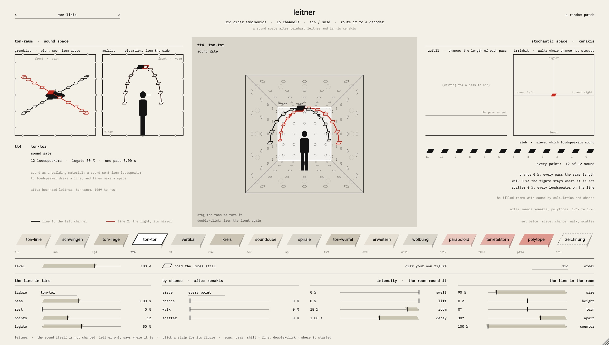

<p align="center"></p>

# leitner

A spatialization plug-in after **Bernhard Leitner** and **Iannis Xenakis**. The sound you give it travels through the room round the listener as two lines of sound, after Leitner's Ton-Raum work: switched from loudspeaker to loudspeaker, drawing figures he built and drew, with the chance, random walks, clouds of points and sieves of Xenakis. It does not change the sound itself: it only says where the sound is.



**[The manual (PDF)](docs/manual/Leitner%20Manual.pdf)**

Since 0.5 it is drawn in the look of the [faltung](https://github.com/femifleming/faltung) plug-ins, on its own cream paper: [before and after](docs/before-after). It is the same instrument, and stays its own plug-in in its own repository: every control is where its name says, and sessions, presets and automation from 0.4 open as they were.

It is an **encoder**: stereo (or mono) goes in, Ambisonics come out (ACN channel order, SN3D normalisation, the format of the IEM and SPARTA plug-ins), 3rd to 7th order. It decodes nothing itself.

| Order | Channels |
| --- | --- |
| 3rd (default) | 16 |
| 4th | 25 |
| 5th | 36 |
| 6th | 49 |
| 7th | 64 |

AU, VST3 and app on macOS; VST3 and app on Windows; VST3, LV2 and app on Linux.

## Install

**macOS (Homebrew):**

```sh
brew tap femifleming/tap
brew trust --tap femifleming/tap
brew install --cask femifleming/tap/leitner
```

Or download `Leitner-macOS.zip`, `Leitner-Windows.zip` or `Leitner-Linux.tar.gz` from the [releases](https://github.com/femifleming/leitner/releases) and copy the plug-ins into your plug-in folders (the manual lists them). The builds are signed but not notarised: on macOS, the Homebrew cask clears the download quarantine for you.

## Routing it to a decoder

1. Put Leitner on a track and give the track as many channels as the order needs (in REAPER: the track's **Route** button, *Track channels*).
2. Pick the same order in Leitner (**order**, under the room).
3. After it, add a decoder at that order with SN3D normalisation, such as the IEM **AllRADecoder** for loudspeakers or **BinauralDecoder** for headphones.

On a track with too few channels for the order you picked, the highest order that fits comes out, and the line under the title says which. On a plain stereo track only a left-right fold of the scene comes out, for checking.

## The space

The left channel is line 1 (black in the drawing) and the right channel is line 2 (red), its mirror image. Nothing counts bars or beats: time is in seconds, and chance can make every pass a different length.

After Leitner:

- **figure**: which space the lines draw (the list is below).
- **pass**, **rest**: how long one pass takes, and how much of it is spent waiting at its end.
- **points**, **legato**: Leitner's sound was switched from loudspeaker to loudspeaker, it did not glide. *points* is how many loudspeakers the figure is built from (all the way up: continuous), and *legato* how far each overlaps the next.
- **size**, **height**, **turn**: how big the figure is, how high it sits (0 is ear height) and which way it faces.
- **apart**, **counter**: how far the two lines stand either side of the figure's direction, and how far line 2 runs behind line 1 (100 %: exactly opposite).
- **swell**: louder where the line comes nearest the body. **lift**: thinner as it rises, fuller as it falls.

After Xenakis:

- **chance**: each pass's length is drawn from an exponential law, as the durations of his stochastic music were.
- **walk**: at every pass the figure takes a Gaussian step in direction and height (a random walk).
- **scatter**: each loudspeaker of the raster is thrown off the line, so the line becomes a cloud of points.
- **sieve**: which loudspeakers of the raster sound at all (unions of residue classes).

And **room**, **decay** (one reverb for the whole sphere, the architecture round the lines), **level**, **order** and **hold** (stop the lines where they are).

A line can pass through the middle of the room: near the centre the higher orders fade, so the sound spreads round you and then leaves on the other side.

## The window

Drawn in the faltung look: one flat cream ground, one darker field for the room, thin lines, lowercase Inter and IBM Plex Mono, rows made of a thin rule with a slanted bar. Ink for line 1 and red for line 2, the one red thing, after the red rods of Leitner's Plexiglas models. It is mirror symmetrical:

- **in the middle**, the room as a thin wireframe in its field, its loudspeakers as small circles, the wall you face as one white face, a solid ink figure standing in it, and the two lines of sound with the loudspeakers each is built from as small slanted chips. **Drag the room to turn it**; double-click it to face front again. However it is turned, all of it stays in its field.
- **on the left, Ton-Raum**: the figure drawn as an architect draws a building, in plan (from above) and elevation (from the side), with its loudspeakers and where each line is sounding now, and what it is in words.
- **on the right, its mirror, stochastic space**: the length chance gave each of the last passes, the trail of the random walk, and the sieve (which loudspeakers sound).
- **under them, the figures** as a row of fifteen folded paper strips, each with a short code (`tl1`, `kr6`, `pt14`...): Leitner's eleven in the sands of the paper, Xenakis's three with the red in them, your own dashed. Click one to choose it.
- **then the controls**: *level*, *hold*, *draw your own figure* and *order* on one line, and the rest in four columns: the line in time, by chance (after Xenakis), intensity and the room round it, the line in the room. The two right-hand columns are read from the right.

Every parameter is a row: drag it (shift for fine steps, or the mouse wheel), double-click to put it back. Lists (*figure*, *sieve*, *order*) open on a click or step when dragged up and down. Rest the mouse on anything for a line about it.

## Programs and your own presets

The programs are at the top left, `< name >`: the arrows step, a click on the name lists eighteen spaces, eleven after Leitner and seven after Xenakis (among them **Persephassa**, six points round you, and **Nomos Gamma**, a scattered cloud that wanders). They leave the Ambisonic order alone. In that list, **save this as a preset...** writes the space to a `.leitner` file in your presets folder (`~/Library/Application Support/FreakiePie/Leitner/Presets` on macOS, `%APPDATA%\FreakiePie\Leitner\Presets` on Windows, `~/.config/FreakiePie/Leitner/Presets` on Linux), and **a random patch** (top right) makes a new space. A new Leitner always opens the same way: every control where it starts, on the first program, nothing by chance.

## The figures, and where they come from

| Figure | What it does | After |
| --- | --- | --- |
| Ton-Linie | a straight line across the room, there and back | Leitner's "line of sound"; the Ton-Röhre's leading path |
| Schwingen | a pendulum across you, slowest at the ends | the Ton-Röhre's swinging space (1973) |
| Ton-Liege | to and fro along the body, low | the Ton-Liege sound chair (1975) |
| Ton-Tor | up one side, over the head, down the other | Ton-Tor (1971), one line rising as one falls |
| Vertikal | floor to ceiling and back | the Wand-Raster's vertical lines (1972) |
| Kreis | a ring round you, the two lines in opposite directions | circling, in the Ton-Röhre and Le Cylindre Sonore |
| Soundcube | four circles in turn at four heights | a sheet of the Soundcube project (1969) |
| Spirale | winding up round the body and down | Spiral-Räume (1976) |
| Ton-Würfel | corner to corner of a cube, eight points | Ton-Würfel (1980/81), which had eight loudspeakers; the corner tour is this plug-in's own |
| Erweitern-Verengen | out from the centre and back | Erweitern/Verengen (1977); set *apart* to 90° |
| Wölbung | a vault overhead, rib by rib | his vaults and Doppel-Wölbung (1999); the six ribs are this plug-in's own |
| Paraboloid | straight lines zigzagging between two skew edges, sweeping a curved surface | Xenakis: the glissandi of Metastaseis and the ruled surfaces of the Philips Pavilion |
| Terretektorh | a flat spiral in towards you, faster and faster, and out again | Xenakis: the accelerating rotations of sound in Terretektorh |
| Polytope | eight points thrown over the sphere, new ones every pass | Xenakis: the points of light and sound of the Polytopes |
| Eigene Zeichnung | your own path, drawn in three dimensions (below) | you, drawing a space before it is built, as Leitner did |

## Drawing your own figure

Click the last strip (*zeichnung*), choose **Eigene Zeichnung** from *figure*, or click **draw your own figure** under the strips. The left-hand side becomes a drawing sheet, three white squares of paper with your path seen from above, from the side and from behind, and your points also appear in the room as small squares on line 1.

- **click** a view to add a point (on the line: between two), **drag** a point to move it, **double-click** it (or press delete) to take it away, **cmd-Z** to undo;
- **shift-drag** on a view, or on the room, to draw a whole new path freehand. In the room it is drawn on the plane through the middle facing you, so turn the room first to draw at any angle;
- drag a point in the room to move it across your view of the room, at its own depth;
- up to 64 points, as a **closed loop** or an **open** line that goes there and back, **curved** through the points or **straight** from one to the next, with the loudspeakers spread evenly by *points* or standing **at your points**;
- **start from a figure...** turns any of the fourteen figures into points you can move.

Size, height, turn, apart, the mirror image, the raster and all of Xenakis's chance work on it as on any figure, and it moves at an even speed along the path. The drawing is saved with the session and in your presets.

## Build

```sh
git clone --recursive https://github.com/femifleming/leitner.git
cd Leitner
cmake -B build -DCMAKE_BUILD_TYPE=Release
cmake --build build --config Release --target Leitner_All
```

`-DLEITNER_BUILD_TESTS=ON` adds `LeitnerTest`, which checks the harmonics, the encoded directions, the mirror image, the raster, the sieves, chance, every order, that the sound passes unchanged, the programs, presets and old sessions, your own drawn figure (the sound follows it, it is saved, freehand strokes are thinned), that a host sees the same parameters as before and a new instance opens at its defaults, works the window's controls with the mouse, and takes pictures of the window, whole and in parts (`python3 docs/manual/make.py` makes the manual from them). `LeitnerTest --render in.wav out.wav channels` runs the processor on a file. On Linux, install JUCE's usual dependencies first (ALSA, FreeType, fontconfig, X11, OpenGL; see the build workflow).

## History

Leitner began in 2026 inside [Cloudfin](https://github.com/femifleming/faltung/tree/main/cloudfin) as Cloudfin's effects followed by a spatial stage (0.1, 0.2). In 0.3 it became a spatialization plug-in only, in its own repository: the effects, and a pulse layer after Mark Fell, Gábor Lázár and Kindohm, were taken out, keeping what belongs to the world of Leitner and Xenakis. Sessions and presets from 0.2 open with their space. 0.4 added a fifteenth figure, your own, drawn in three dimensions; sessions from 0.2 and 0.3 open on the figure they had (a host's automation of *figure* made with 0.3 may point one figure along). 0.5 changed how it looks and nothing else: the typed sheets after Leitner's 1969 Soundcube drawings became the faltung look on the same cream paper, with the same parameters, programs, presets and sessions. One fix came with it: as a VST3 in REAPER on a track of more than two channels, 0.4 was given a stereo input and output and played only the stereo fold; 0.5 takes the track's width, so every Ambisonic channel comes out.

## Credits and notes

- This is an homage. It is not affiliated with or endorsed by Bernhard Leitner or the estate of Iannis Xenakis; no drawing, recording, score or text of theirs is included.
- The Xenakis ideas (stochastic durations, random walks, clouds of points, sieves; Metastaseis and the Philips Pavilion, Terretektorh, Persephassa, Nomos Gamma, the Polytopes) were written from general knowledge of his work and *Formalized Music*, not checked against the scores: the three figures are interpretations.
- Sources for the figures and the drawing style: *P.U.L.S.E.* (Hatje Cantz / ZKM, 2008), which reprints his 1977 Sound Space Manifesto and the Soundcube sheets; Sven Sterken, "Architecture without Walls: Bernhard Leitner's Soundcube" (2024); his 2011 lecture "Sound Spaces"; and the work list at bernhardleitner.at.
- The Ambisonic conventions follow the IEM Plug-in Suite and SPARTA, and the room is built like the IEM FdnReverb, as in Pinkie Pie's Balloon Palace, whose Ambisonics code this shares. No code from IEM or SPARTA is included.
- The look since 0.5 is that of the faltung plug-ins; its controls are faltung's own (`Source/Ui.*`), copied here. The typefaces, Inter (Rasmus Andersson) and IBM Plex Mono (IBM), are under the SIL Open Font License (`Resources/fonts`).
- Licence: AGPL v3. Built with JUCE.
